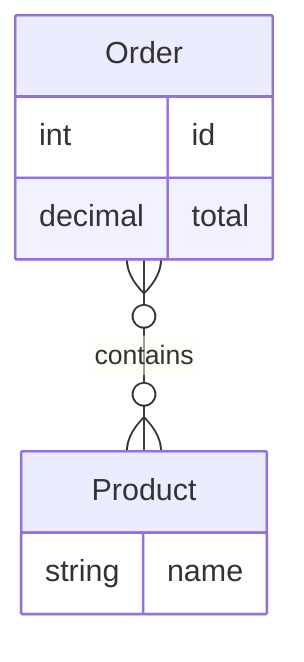

# Web Shop — Data Model (ERD)

> Generated by Panos from the requirement store (15/19 items approved). Do not edit by hand: change the requirements and regenerate.

- **DATA-001 — Order (v1, APPROVED)**
- **DATA-002 — Product (v1, APPROVED)**
